<div align="center">


# حدوتة · Hadota AI Barista

**An Egyptian-Arabic coffee agent that learns every user's taste from ratings and words.**
Branching questions · expert coffee rules · per-user contextual bandit · community tables · full test and analytics suite.

     

</div>

> **ملخص بالمصري:** حدوتة باريستا ذكي لمدمني القهوة. بيسألك أسئلة بتتغيّر حسب إجاباتك، وبيطلّعلك خلطة بن وتحميص وطحنة وتحويجة، وكل ما تقيّم أو تكتب رأيك بيتعلم ذوقك أكتر (خوارزمية LinUCB لكل مستخدم). فيه مجتمع «قهوة الحكواتية» بترابيزات وشات، وسيرفر على Supabase، واستضافة على Vercel، ومجموعة اختبارات وتحليل بيانات تثبت إنه بيتعلم فعلاً.

---

## Contents

1. [What problem does it solve?](#1-what-problem-does-it-solve)
2. [See it](#2-see-it)
3. [Architecture](#3-architecture)
4. [Tech stack and the role of each tool](#4-tech-stack-and-the-role-of-each-tool)
5. [Repository map](#5-repository-map)
6. [How the app is built](#6-how-the-app-is-built)
7. [The question engine](#7-the-question-engine)
8. [The recommendation engine (expert system)](#8-the-recommendation-engine-expert-system)
9. [AI architecture](#9-ai-architecture)
10. [Models: what is used and what is not](#10-models-what-is-used-and-what-is-not)
11. [Reinforcement learning in detail](#11-reinforcement-learning-in-detail)
12. [Feedback to taste: tags and Arabic text](#12-feedback-to-taste-tags-and-arabic-text)
13. [Does it really learn? The evidence](#13-does-it-really-learn-the-evidence)
14. [Backend: Supabase](#14-backend-supabase)
15. [Voice and sound](#15-voice-and-sound)
16. [PWA and offline](#16-pwa-and-offline)
17. [Deployment: Vercel + Supabase](#17-deployment-vercel--supabase)
18. [Testing](#18-testing)
19. [Analytics package](#19-analytics-package)
20. [The catalog](#20-the-catalog)
21. [Limitations and roadmap](#21-limitations-and-roadmap)

---

## 1. What problem does it solve?

Hadota's customers are **coffee addicts** who drink several cups a day and keep looking for a cup they cannot find anywhere else. Generic recommenders fail them in two ways: they ask the same questions of everybody, and they never get better at *you*.

Hadota answers with three ideas:

| Idea | How |
|---|---|
| Ask only what matters | A branching questionnaire. A Turkish-coffee drinker never sees espresso questions; a latte drinker is asked about milk. |
| Recommend with coffee knowledge, not guesses | A rule-based expert system picks bean, roast, grind, dose, water, temperature and the spices to **grind with the beans** (tahweeg). |
| Get better at *this* user | A per-user contextual bandit (LinUCB) plus learned taste offsets, fed by star ratings and by the user's own words ("too bitter", "مش حامضة كفاية"). |

It speaks Egyptian Arabic, has a café-ambience entrance with the barista greeting "أيوة جااااي", keeps every recipe the user generated (with favourites and a full recipe page), and has a community ("قهوة الحكواتية") with a Twitter/Facebook-style news feed («آخر الأخبار») plus members-only tables that every member must approve newcomers into.

## 2. See it

<div align="center">

</div>

| Splash | Home | Question | Result |
|:--:|:--:|:--:|:--:|
|  | 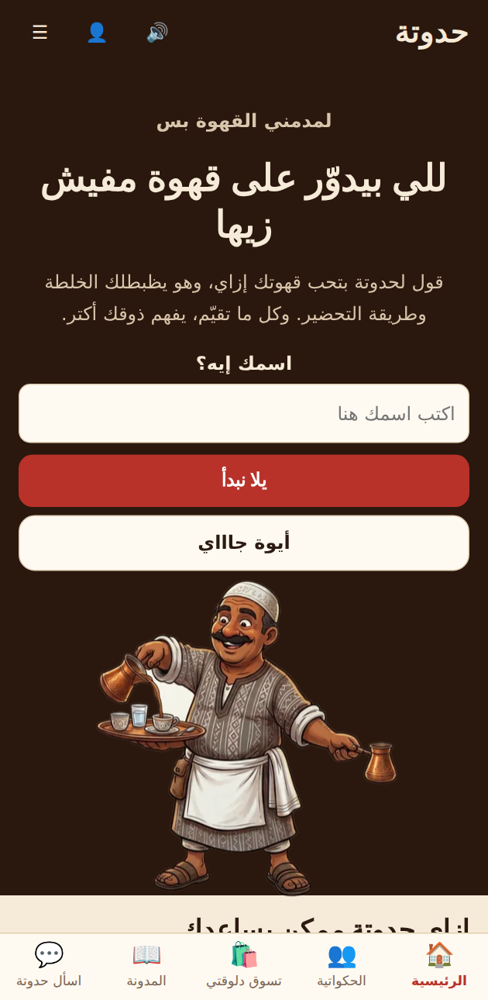 | 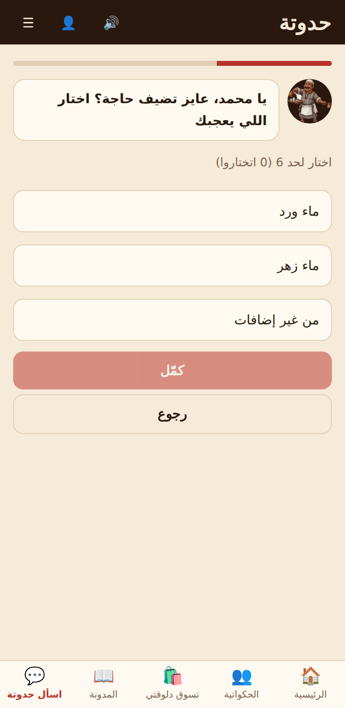 | 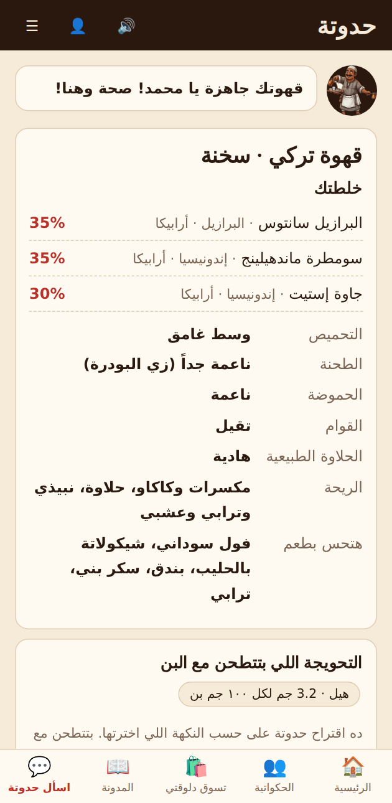 |

| Your opinion | "Next time…" | What Hadota learned | Community |
|:--:|:--:|:--:|:--:|
| 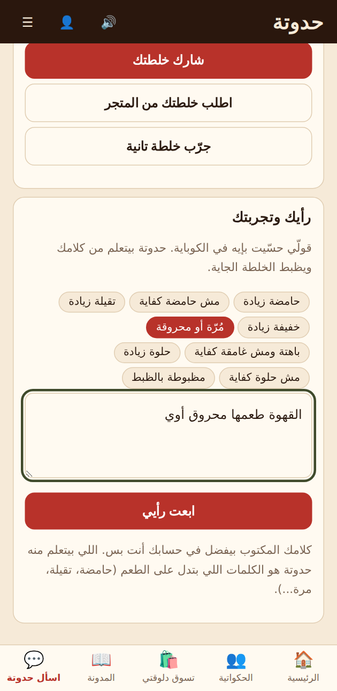 | 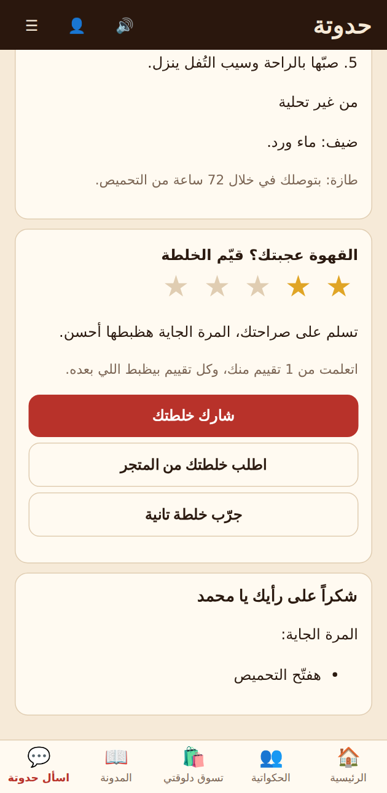 | 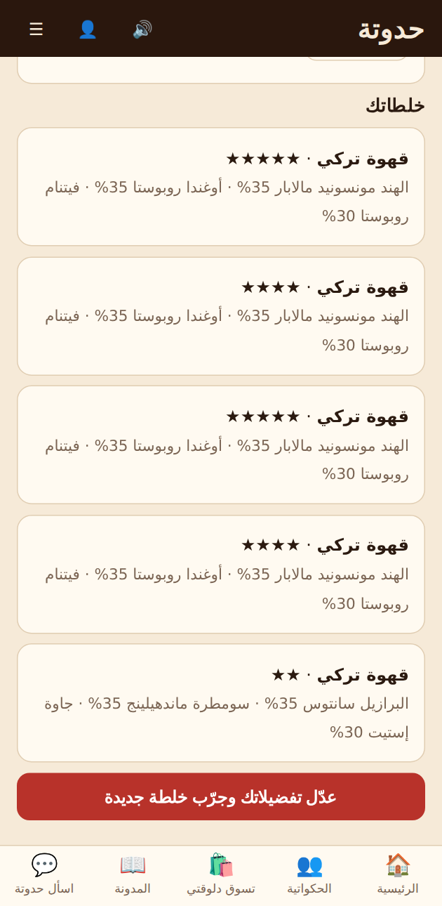 | 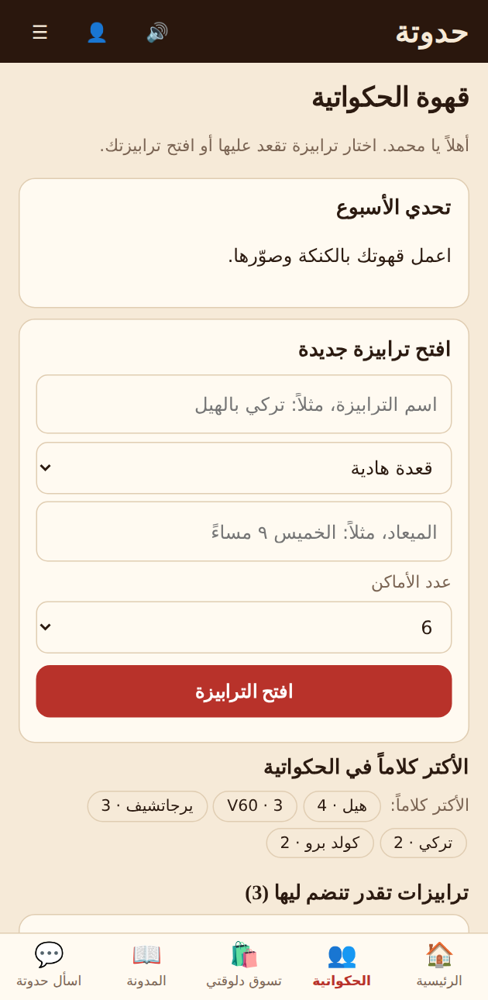 |

| Usage | Recipe page | Favourites | Menu |
|:--:|:--:|:--:|:--:|
| 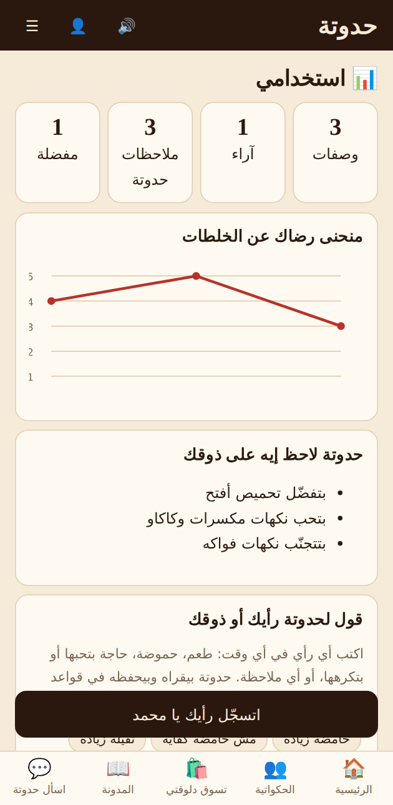 | 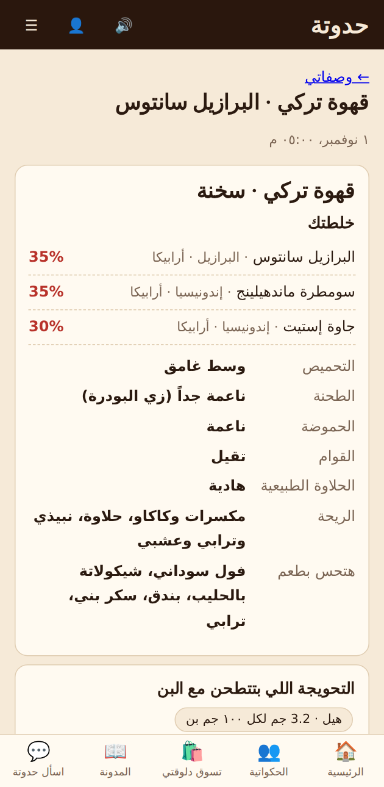 | 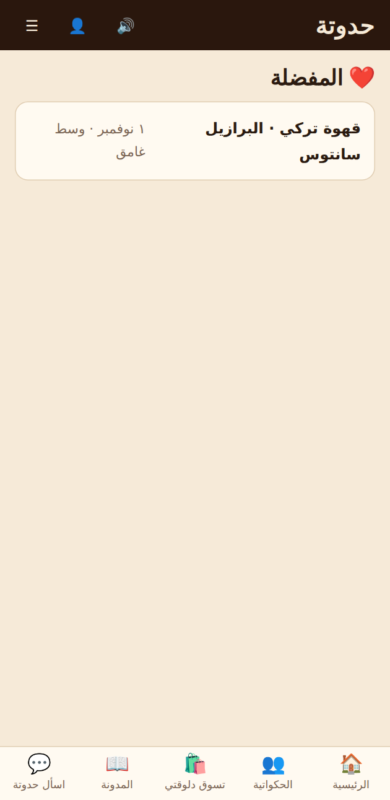 | 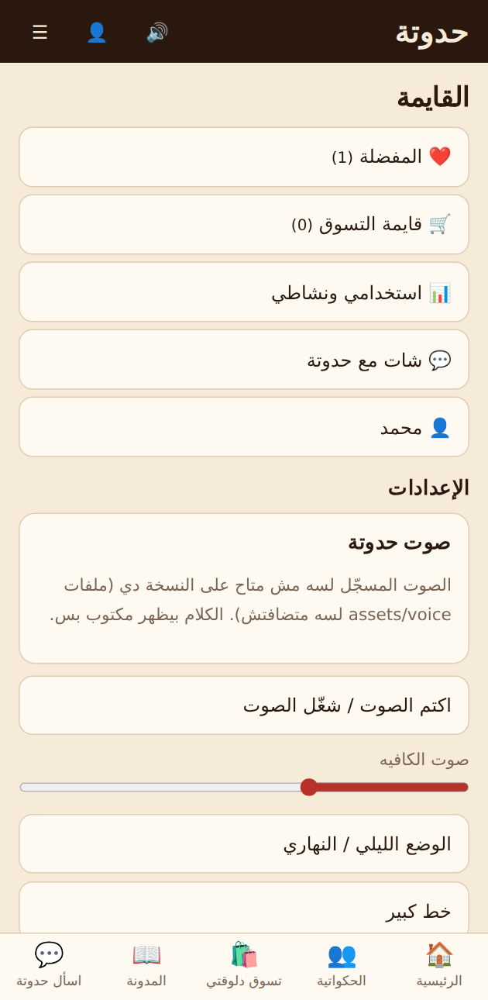 |

| Product page | Tables (outsider) | Members and requests | News feed |
|:--:|:--:|:--:|:--:|
| 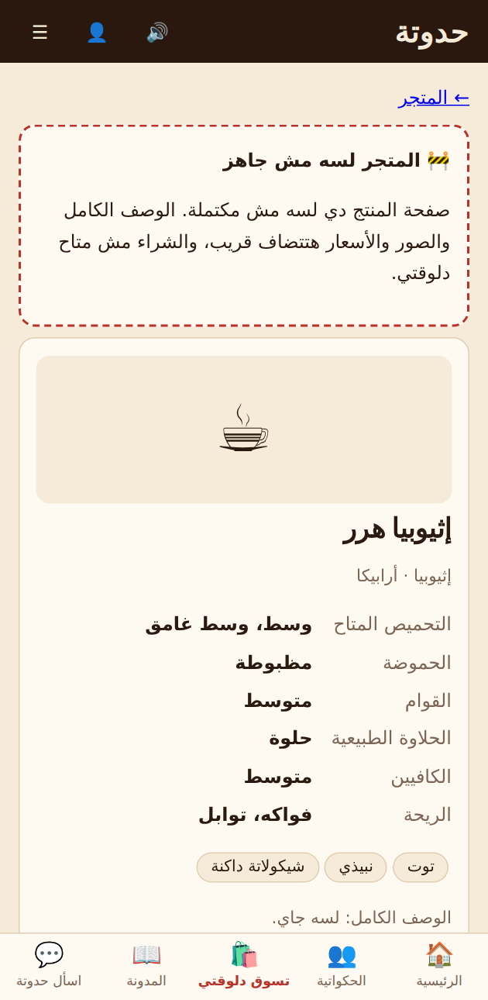 | 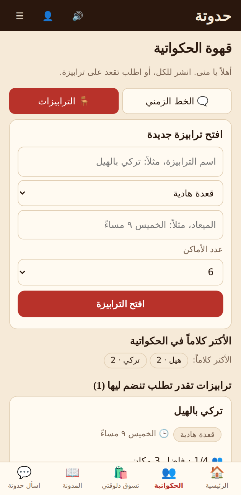 | 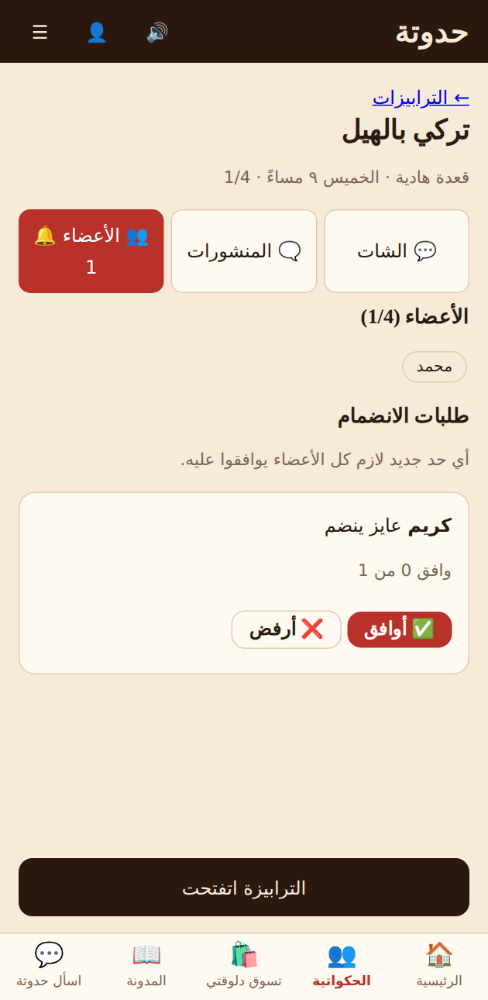 | 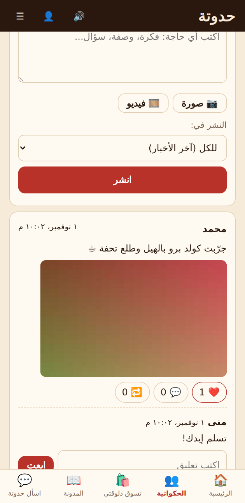 |

<sub>Screenshots are real renders of the app, taken in a sandbox without Google Fonts, so type looks slightly different from the live site.</sub>

## 3. Architecture

<div align="center">
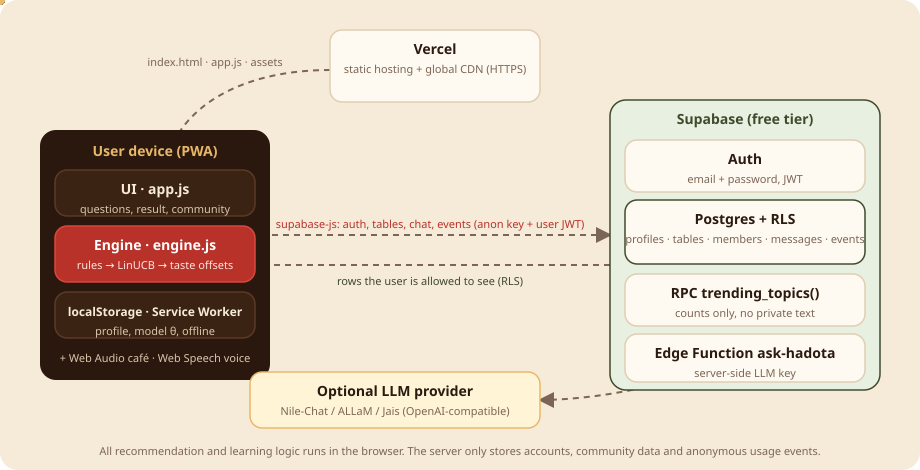
</div>

**Principle: intelligence at the edge, the server only for identity and community.** All questioning, recommendation and learning run in the browser (`engine.js`). That makes the app fast, usable offline, and private: a user's taste model never has to leave the device unless they have an account.

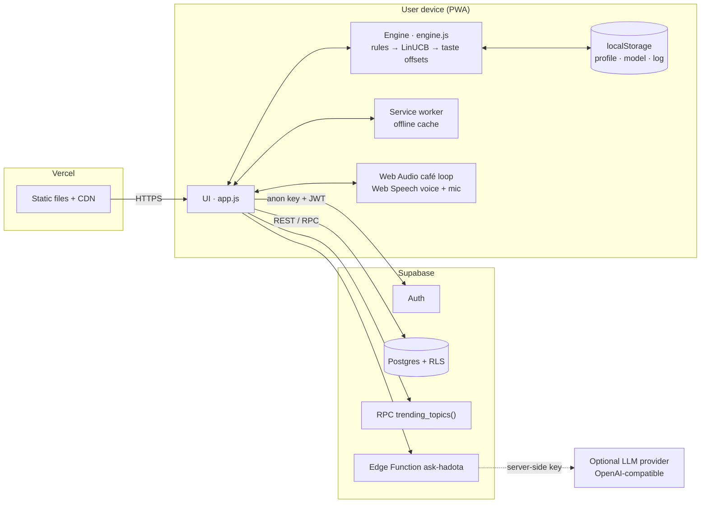

One session end to end:

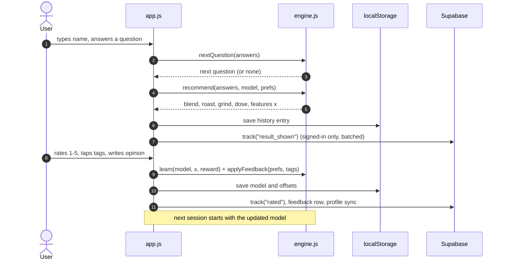

## 4. Tech stack and the role of each tool

| Layer | Tool | Role |
|---|---|---|
| Language | **Vanilla JavaScript (ES2020)**, HTML, CSS | No framework and no build step: the whole app is five static files, easy to host and to audit. |
| UI | Hand-written CSS with design tokens, RTL layout, dark mode | Egyptian-café palette; fonts Tajawal (body) and El Messiri (headings) from Google Fonts. |
| Engine | **`engine.js`** (pure functions) | Question flow, expert scoring, bandit learner, feedback tags. Deterministic and unit-testable in plain Node. |
| Content | `data.js`, catalog in `engine.js` | Egyptian-Arabic strings; 25 beans, 33 drinks, 32 flavours, 37 add-ons. |
| Client storage | `localStorage` | Profile, model matrices, history, usage log (guests stay fully local). |
| PWA | `manifest.webmanifest`, `sw.js` | Installable app, offline fallback. Network-first so updates always arrive. |
| Audio | **Web Audio API** | Looping café ambience (recorded loop, base64 or file). |
| Voice out | **Recorded clips only** (one male Egyptian voice, rendered once with VoiceTuT-TTS) | The app never uses a device voice, so Hadota sounds the same on every phone and PC. No clips yet = silent, captions still type. |
| Voice in | Web Speech API (`SpeechRecognition`, `ar-EG`) | 🎤 on every question (spoken answers are matched to options by `matchOptions`) and in the chat. Chrome/Edge send audio to the vendor's servers. |
| Backend | **Supabase**: Auth, Postgres, Row Level Security, RPC, Edge Functions, Storage | Accounts, tables, join requests and votes, chat, news-feed posts/likes/comments/reposts, photo and video storage, usage events, trending topics. |
| Hosting | **Vercel** (static) | Global CDN, HTTPS (required for install/service worker), preview deploys. |
| Tests | Node built-in **`node:test`**, Python `unittest`, **Playwright** (Chromium) | Correctness, learning, analytics, UI end-to-end, voice. |
| Analytics | **Python** (pandas, numpy, matplotlib) | Is the agent learning? A/B lift, calibration, funnel, retention, charts. |
| CI | GitHub Actions | Runs all suites on every push (`.github/workflows/ci.yml`). |
| Origin | TypeScript + React prototype | The engine was first written in TypeScript (`reference-src/`) and ported to plain JS. |

## 5. Repository map

```text
index.html · app.js            UI, routing, community, feedback box, learning panel, A/B arm, telemetry
engine.js                      QUESTIONS, nextQuestion, recommend, LinUCB (newModel/learn/stats), taste offsets, tags
data.js                        Egyptian-Arabic strings (T) and constants
backend.js                     One interface, three backends: Supabase · claude.ai preview · local-only
config.js                      Supabase URL + anon key (public by design)
sw.js · manifest.webmanifest   PWA
assets/                        character (webp), café loop (mp3), optional recorded voice clips
supabase/schema.sql            base: 8 tables, RLS, triggers, trending_topics()
supabase/migrations/002_*.sql  members-only tables, join requests approved by all members, social news feed, media buckets
supabase/functions/ask-hadota  Edge Function: server-side LLM call
tests/                         engine · learning · simulator · e2e (Playwright) · voice
analytics/                     Python package: metrics, charts, HTML report
scripts/                       demo event generator, voice-lines.mjs (61 sentences) + render_voice.py (Colab, male voice)
docs/                          LEARNING.md · TESTING.md · DEPLOY.ar.md · animated assets
reference-src/                 original TypeScript sources (archive)
```

## 6. How the app is built

**Evolution.** The project grew in deliberate steps, each one verified before the next:

| Step | What was added | Why |
|---|---|---|
| 1 | TypeScript prototype: question engine, catalog, recommender, first LinUCB | Get the domain logic right before any UI |
| 2 | Static Egyptian-Arabic app (home, splash with café sound, name saved per user) | A real product feel, no framework needed |
| 3 | Branching questions, tahweeg as a *suggestion*, shop and blog | Customers asked for coffee-specific, personal flows |
| 4 | Accounts, community tables, chat, topics (Supabase + RLS) | A community for addicts needs real online accounts |
| 5 | Learning upgrade: 25 candidates, feedback tags, Arabic text reading, A/B holdout | The learning had to be *provable* |
| 6 | Test suites, simulator, analytics package, CI | "Master full-stack" quality bar |
| 7 | PWA, male-first voice picker, recorded-voice pipeline | Installable app and the right voice |

**Runtime construction.** `index.html` loads `config.js`, the Supabase UMD script, then `engine.js`, `data.js`, `backend.js`, `app.js`. These are classic scripts sharing one global scope, which keeps the engine importable in Node tests with a two-line loader (`new Function(src + "return {…}")`).

**State.** One user object per account, in `localStorage` and (when signed in) mirrored to `user_data`:

```json
{ "name": "…", "arm": "learner|control",
  "model": { "n": 7, "A": "12×12", "b": "12" },
  "prefs": { "pa": -0.5, "pb": 0, "ps": 0, "pr": -0.5 },
  "history": [ { "answers": {}, "blend": [], "x": "12 features", "rating": 4, "fb": { "tags": [], "text": "" } } ] }
```

## 7. The question engine

Questions are declarative: each has a `when(answers)` guard and `options(answers)`. `nextQuestion` returns the first unanswered question whose guard is true, and **auto-answers** questions that have a single possible option.

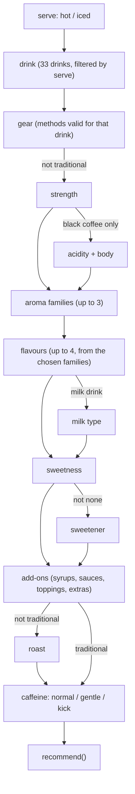

**Spoken answers.** Every question has a 🎤 button. The browser's `ar-EG` recogniser returns up to 3 transcripts; `matchOptions` normalises Arabic (diacritics, أإآ، ة، ى، "ال"), compares each option label word by word (exact, prefix, one-letter typo) plus a small synonym list (سخنة/ساخن/دافي, ساقعة/مثلج/ايس…), and picks the option (or several, for multiple choice). Ties and no-match are refused with a message rather than guessed. Each question is spoken **once**: choices in a multiple-choice question update the screen without repeating the line.

Examples of branching: *Turkish/Arabic coffee* skips strength, acidity, body, aroma and roast (roast is fixed medium-dark); *milk-free espresso* is asked acidity and body; *iced* drinks only offer iced add-ons. Add-ons never include ground spices: those are **suggested by Hadota** and ground with the beans (see §8).

## 8. The recommendation engine (expert system)

`recommend(answers, model, prefs)` is a pipeline:

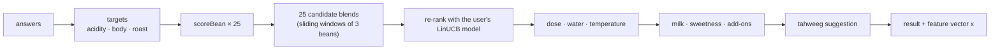

**Roast** (`pickRoast`): an explicit request always wins. Otherwise: traditional coffee → medium-dark; fruity/floral majority → light; roasted/spicy majority → medium-dark; two or more "roasted" flavours → dark; milk drinks (≥100 ml) are pushed one step darker; learned offset `pr` shifts the result.

**Bean score** (`scoreBean`), summed per bean:

| Term | Points |
|---|---|
| Acidity close to target | `3 − 1.2·|acidity − target|` |
| Body close to target | `3 − |body − target|` |
| Requested flavours present in the bean's notes | `2.2 × matches` (max 3) |
| Requested aroma families present | `1.2 × matches` |
| Bean is sold in the chosen roast | `+1.2` |
| Caffeine preference (gentle / kick) | `(3 − caffeine)·0.8` or `caffeine·0.9` |
| Requested region | `+3.5` |
| Requested species (Arabica/Robusta/Liberica/Excelsa) | `+6` |
| Milk drink and body ≥ 2 | `+0.8` |
| Learned sweetness offset active | `3 − 0.8·|sweet − (2 + ps)|` |

**Blend**: the lead bean plus the next two in each window; shares ∝ `(score − min + 1)²`, rounded to multiples of 5 that sum to exactly 100 (largest-remainder).

**Brew parameters** (`doseFor`):

| Method | Grind | Dose | Water (output for espresso) | Temp | Time |
|---|---|---|---|---|---|
| Ibrik / kanaka (Turkish, Arabic) | extra fine | 7 g | 70 ml | n/a | 3 min |
| Espresso | fine | 9 g per shot | 30 ml per shot | 93 °C | 30 s |
| Moka pot | medium-fine | 8 g per shot | 56 ml per shot | n/a | 4 min |
| AeroPress | medium-fine | 7.5 g per shot | 50 ml per shot | 90 °C | 2 min |
| French press | coarse | 15 g | 240 ml | 94 °C | 4 min |
| Pour-over | medium | 15 g | 240 ml | 94 °C | 3 min |
| Cold brew | coarse | 40 g | 320 ml | cold | 14 h |
| Phin (Vietnamese) | medium-fine | 20 g | 100 ml | 92 °C | 5 min |

Strength scales dose by 0.9 / 1 / 1.15. These values are checked by tests against accepted ranges (§18).

**Tahweeg** (spices ground with the beans, suggested, never chosen by the user) in `app.js`: cardamom 4 g, cinnamon 2 g, clove 0.5 g, nutmeg 0.3 g, anise 1 g, black pepper 0.4 g, mastic 0.5 g, ginger 1 g, saffron 0.1 g **per 100 g of beans**; Arabic coffee defaults to cardamom 10 g + saffron + clove; nutty/cocoa flavours add cinnamon and cardamom, sweet flavours add mastic and cinnamon, roasted flavours add cardamom and clove; fruity/floral wishes get none. *These ratios are reasonable defaults, not roaster-verified.*

## 9. AI architecture

Hadota is **not** one model. It is four cooperating layers, ordered from most reliable to most personal, plus an optional language layer.

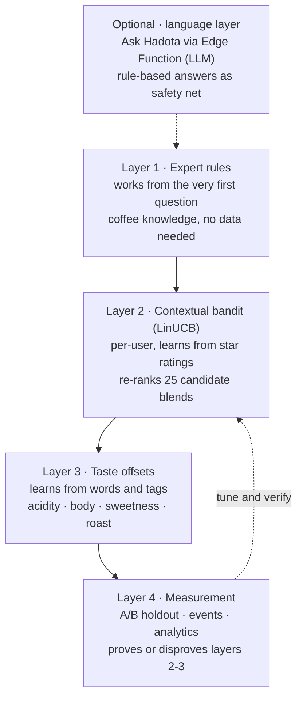

| Layer | Technique | Data needed | Fails safe to |
|---|---|---|---|
| 1 Expert rules | Hand-built scoring and brew tables | none | n/a (always available) |
| 2 Bandit | Online ridge regression with UCB exploration, d = 12 | ratings (full trust after 3) | Layer 1 |
| 3 Offsets | Bounded additive shifts from tags and Arabic keywords | any feedback | Layer 1 |
| 4 Measurement | 10 % control group, events table, Python report | usage | n/a |
| Optional language | LLM through a Supabase Edge Function | none | rule-based "gold" answers |

Design choices that matter: **cold start is the rules** (trust = 0), **nothing the learner does can break the brew parameters** (it only chooses among candidate blends and nudges targets within ±1.5 levels), and **every layer can be switched off** without breaking the one below.

## 10. Models: what is used and what is not

> Honest inventory: **no neural network runs inside the app, and nothing is fine-tuned.** With a handful of ratings per person, a small interpretable online model beats a large one, and it runs on a phone with no server.

| Component | Type | Status | Notes |
|---|---|---|---|
| Expert scoring (`scoreBean`) | Hand-built rules | **Active** | The reliable baseline |
| LinUCB per user | Contextual bandit (online ridge regression + UCB) | **Active** | Custom ~40-line implementation, no library |
| Taste offsets + Arabic keyword reader | Heuristic online adaptation, regex NLU | **Active** | Only produces tags a user could tap |
| Control-group A/B | Experiment design | **Active** (10 %) | `HOLDOUT` in `app.js` |
| Device TTS | Web Speech `speechSynthesis` | **Active** | Prefers a male Egyptian voice (e.g. *Microsoft Shakir*); lowers pitch if only a female voice exists |
| Browser STT | Web Speech `SpeechRecognition` (`ar-EG`) | **Active** (Chrome) | Audio is processed by the browser vendor |
| Egyptian male TTS clips | **VoiceTuT-TTS** (Apache-2.0 per its model card), built-in speaker "Mohammed" | **Pipeline ready, clips not rendered by default** | Render once on free Colab with `scripts/render_voice.py` |
| Egyptian chat LLM | **Nile-Chat-4B**, or ALLaM-7B / Jais-2-8B | **Optional, off by default** | Needs a provider that hosts the model and three Edge Function secrets |
| Claude (`sample`) | LLM | Only inside the claude.ai preview | Not part of the deployed app |
| Alternative TTS | Habibi-TTS (EGY), MMS-TTS-ara | Evaluated | MMS-TTS-ara reads Modern Standard Arabic and its licence is non-commercial (check before use) |

## 11. Reinforcement learning in detail

The learner is a **contextual bandit**: reinforcement learning with one decision per round and no state transitions. Each recommendation is an *action*, the user's rating is the *reward*, and the goal is to maximise future ratings while still exploring.

<div align="center">
</div>

**Why a bandit and not deep RL?** A user gives perhaps 5 to 30 ratings in total. Deep RL needs thousands of samples per user; a bandit with 12 features learns meaningfully from 3. It is interpretable ("what does Hadota think I like?") and needs no GPU.

**Context vector `x` of a blend** (12 numbers in 0..1, `featuresOf`):

| Index | Feature |
|---|---|
| 0 | Acidity (blend-weighted ÷ 3) |
| 1 | Body (÷ 3) |
| 2 | Natural sweetness (÷ 3) |
| 3 | Caffeine (÷ 3) |
| 4-10 | Share of the blend in each aroma family: fruity, floral, sweet, nutty-cocoa, spices, roasted, other |
| 11 | Roast level (light = 0 … dark = 1) |

**Per-user state:** `A` (12×12, starts as identity) and `b` (12 zeros). **Reward** from stars: $r = (\text{stars} - 3)/2 \in [-1, 1]$.

**Update:** $A \leftarrow A + xx^\top$, $\; b \leftarrow b + r\,x$, $\; n \leftarrow n+1$.
**Re-rating the same blend** replaces the old reward instead of double counting: $b \leftarrow b + (r_{new} - r_{old})\,x$.
**Skipping** ("try another blend" without rating) is a small penalty: $r = -0.25$.

**Prediction and exploration** for a candidate with features $x$:

$$\hat\mu = \hat\theta^\top x,\quad \hat\theta = A^{-1}b,\qquad \sigma = \alpha\sqrt{x^\top A^{-1} x},\quad \alpha = 0.35$$

**Final ranking** of the 25 candidates:

$$\text{score}_i = \text{norm}_i + \tau(n)\,\big[\,8\,(\hat\mu_i - \bar\mu) + 0.6\,\sigma_i\,\big],\qquad \tau(n)=\min(1, n/3)$$

where $\text{norm}_i$ is the expert score rescaled to [0, 1] across candidates, $\bar\mu$ is the mean prediction (so only *differences between blends* matter, not the user's overall mood), and $\tau$ ramps trust from the rules to the learner over the first three ratings. A pick that is not the expert's first choice is logged as `explored`.

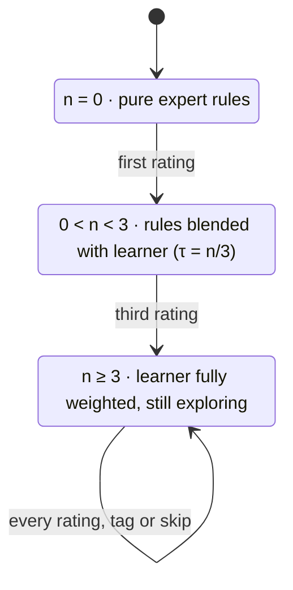

**Hyper-parameters** (`REC_CFG` in `engine.js`) were tuned on simulated users with seeds separate from the evaluation seeds:

| Parameter | Old | Now | Effect |
|---|---|---|---|
| Candidates | 6 | **25** | The learner can reach every bean, not just the expert's top few |
| Gain on predicted reward | 4 | **8** | Stronger personalisation once trusted |
| Trust ramp (ratings) | 5 | **3** | Learner takes over sooner |
| α (uncertainty) | 0.35 | 0.35 | Unchanged |
| Exploration weight | 0.6 | 0.6 | Unchanged |

## 12. Feedback to taste: tags and Arabic text

After every result the user can say what they felt. Each tag moves one of four **taste offsets** by half a level (bounded to ±1.5), and the offsets bend the *targets* used by the expert score on the next recommendation, even if the user answers the questions identically.

| Tag (Arabic) | Offset | Effect next time |
|---|---|---|
| حامضة زيادة | acidity −0.5 | lower acidity target |
| مش حامضة كفاية | acidity +0.5 | higher acidity target |
| تقيلة زيادة | body −0.5 | lighter body |
| خفيفة زيادة | body +0.5 | fuller body |
| مُرّة أو محروقة | roast −0.5 | lighter roast |
| باهتة ومش غامقة كفاية | roast +0.5 | darker roast |
| حلوة زيادة | sweetness −0.5 | less sweet beans |
| مش حلوة كفاية | sweetness +0.5 | sweeter beans |
| مظبوطة بالظبط | none | keep going |

**Opinions any time.** The opinion box is on every recipe page, under the result, and on the usage page (general taste statements). Besides tapping tags, the user can type anything. `extractRules` reads each clause with cues for liking (بحب، عايز، نفسي…) and disliking (مبحبش، بكره، بلاش، مش عايز…), finds flavour-family words (فواكه، شوكولاتة، توابل…), and the caffeine wish (قليل / تصحصحني). Results are stored per user as **taste rules** that change the scoring on every later session:

| The user writes | Stored rule | Effect |
|---|---|---|
| "بحب الشوكولاتة والمكسرات ومبحبش الفواكه" | likes nutty-cocoa, avoids fruity (±1 per statement, bounded ±2) | `+1.6 × weight` on every bean with that aroma family |
| "عايزها تصحصحني" | caffeine = kick | used when the caffeine question was not answered |
| "حامضة شوية" | acidity offset −0.5 | lower acidity target |

`ruleLines(prefs)` renders the current rules as Arabic sentences; they are shown on the usage page and sent (without the user's name) to the optional LLM so chat answers respect them. The opinion text is kept in the user's profile as a timeline of notes with what Hadota changed.

Free text is read by `tagsFromText`: Arabic is normalised (diacritics removed, أإآ→ا, ى→ي, ة→ه) and matched against ordered regular expressions with negation handled first (so "مش حامضة" becomes *not-bright*, not *too-acidic*), and a false-positive guard ("أول مرة بالمية" produces nothing). It is a keyword reader, not language understanding, and it can only produce tags that exist in the table. The written text stays in the user's own profile; **only the tags** go to the analytics events.

## 13. Does it really learn? The evidence

Three independent lines of proof, from cheapest to strongest:

**A. Simulation (offline).** Simulated users have a hidden stable taste and rate what they get; their stated answers are only partly informative. Evaluated on 5 held-out seeds × 200 users × 30 sessions with the real `engine.js`:

<div align="center">
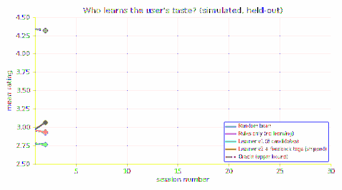
</div>

<div align="center">
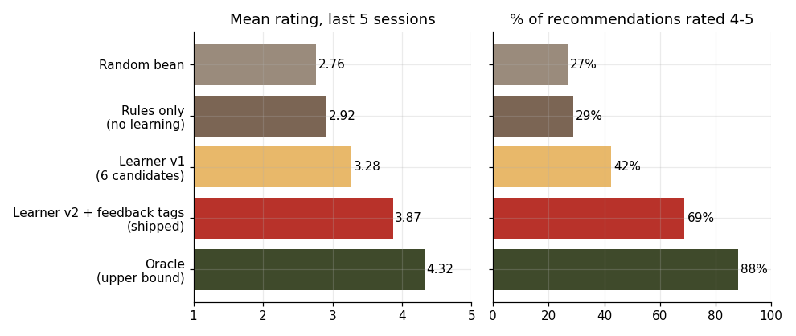
</div>

| Policy | First 5 sessions | Last 5 sessions | Rated 4-5 (last 5) |
|---|---|---|---|
| Random bean | 2.78 | 2.76 | 27 % |
| Rules only | 2.93 | 2.92 | 29 % |
| Learner v1 (6 candidates) | 2.97 | 3.28 | 42 % |
| **Learner v2 + feedback tags (shipped)** | **3.21** | **3.87** | **69 %** |
| Oracle (upper bound) | 4.32 | 4.32 | 88 % |

*What this shows:* the mechanism works and the upgrade roughly doubled the gain. *What it does not show:* that real people behave like the simulated ones. The hidden taste and noise are the author's model, and the oracle shares that model, so read it as a comparison, not a target.

**B. Tests that fail if learning breaks** (`tests/learning.test.mjs`): liked styles are predicted higher than disliked ones; re-rating does not double count; a new user gets exactly the rules' answer; "too acidic" feedback really lowers the next acidity; the learner beats rules and random by ≥ 0.4 stars in simulation.

**C. A/B test with real users (the real proof).** A deterministic 10 % of accounts (hash of name and creation time) form a **control arm** that gets recommendations with no personalisation. Events go to the `events` table; export and run the report:

```bash
python3 -m analytics.report --events events.csv --out report
```

The charts below come from **simulated demo events** with the same schema, to show what the report looks like:

| Learner vs control | Are predictions grounded? |
|:--:|:--:|
| 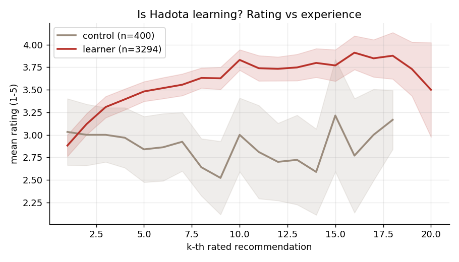 | 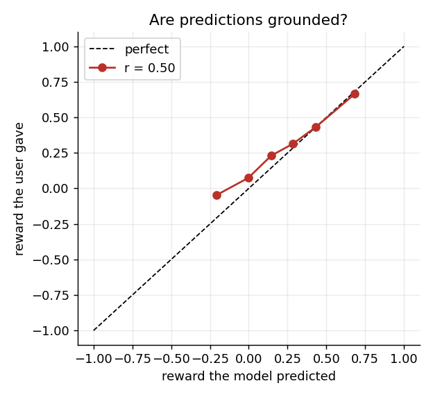 |

| Does telling Hadota what was wrong help? | Does each user improve? |
|:--:|:--:|
| 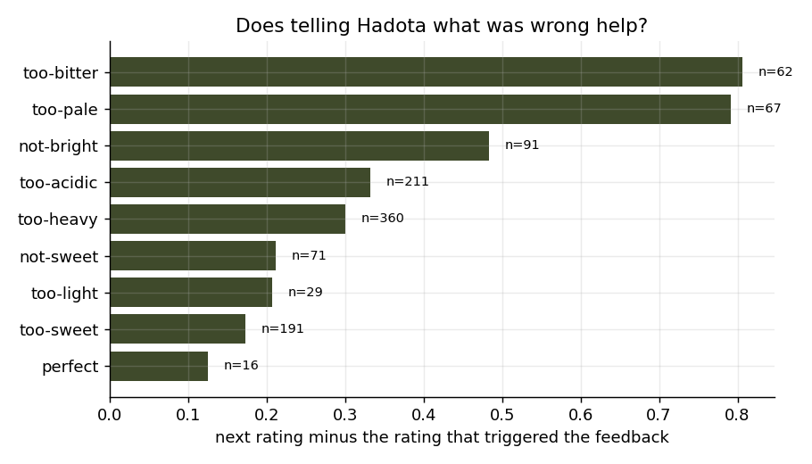 | 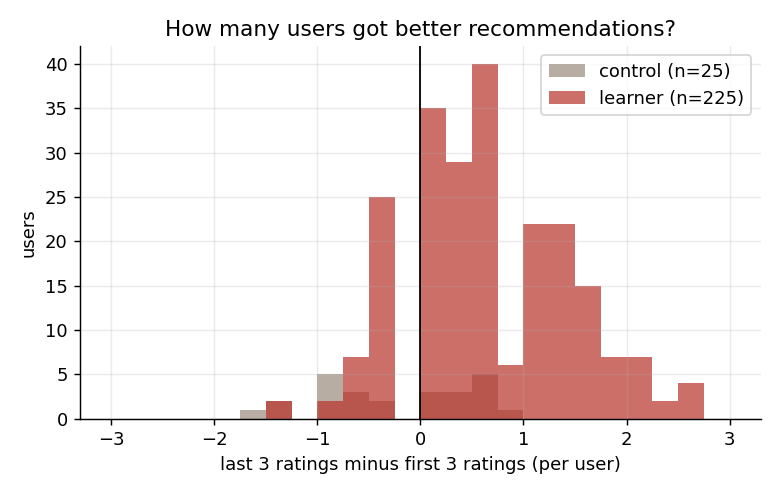 |

**Success criteria** (see `docs/LEARNING.md`): learner minus control ≥ +0.3 stars from the 6th rating on with the 95 % interval above zero; correlation between predicted and given reward > 0.3; at least 60 % of users with 8+ ratings improving by more than 0.2 stars. If these are not met after about 30 users per arm, the report says *NOT PROVEN*.

## 14. Backend: Supabase

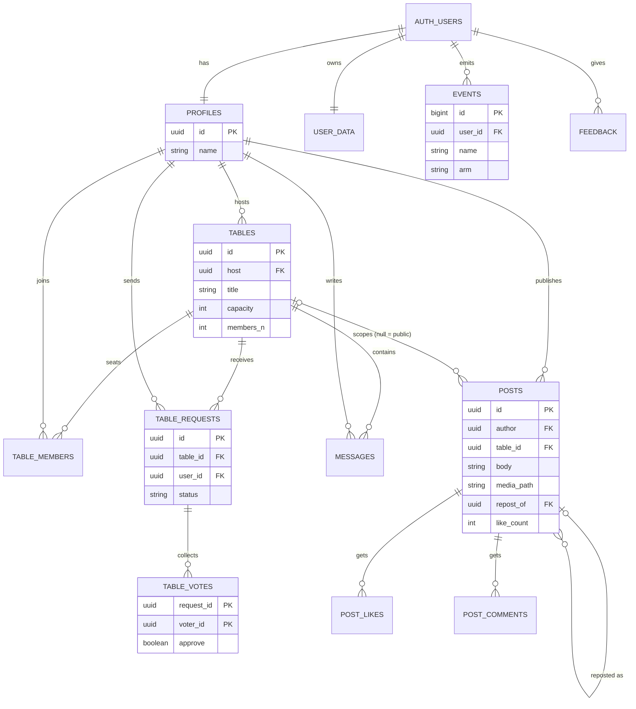

**Joining a table needs every member.** Nobody can insert themselves into `table_members` any more (that policy was removed). A newcomer sends a `table_requests` row; each current member casts one vote in `table_votes`; a trigger runs `resolve_request()`: any "no" rejects the request, and when **every current member** has said yes and a seat is free, the newcomer is seated. If a member leaves, pending requests are re-checked against the remaining members. Only members can see who sits at a table, its chat, its feed and its pending requests; outsiders see the title, vibe, time and seat count.

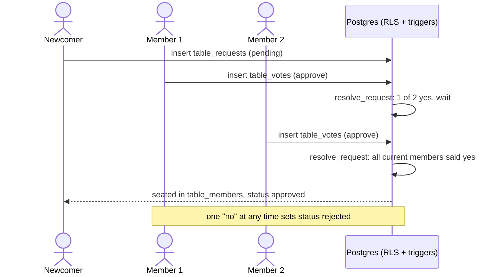

**News feed (آخر الأخبار).** `posts` (text, optional photo or video, optional `repost_of`), `post_likes`, `post_comments`; counters are kept by triggers. `table_id` null = public feed for every signed-in user; a table id = members only (enforced by RLS). A private post can only be reposted inside its own table. Photos are compressed in the browser (max 1280 px, JPEG) before upload; videos are limited to 15 MB. Public media goes to the public `media` bucket under `<user id>/…`; table media goes to the private `media-private` bucket under `<table id>/<user id>/…` and is shown through short-lived signed URLs.

| Concern | How it is solved |
|---|---|
| Accounts | Supabase Auth (email + password); a trigger creates the `profiles` row from the sign-up name. |
| Community tables | `tables` (title, vibe, time, capacity 2-12); the host is auto-seated by a trigger. |
| Capacity race | A `before insert` trigger on `table_members` **locks the table row** and counts seats, so two people cannot take the last one. |
| Chat and member list privacy | RLS: only members of a table can read its members, messages, feed and pending requests. |
| Private learning data | `user_data` is readable and writable only by its owner. |
| Trending topics | `trending_topics()` is a `security definer` function over a fixed word list; it returns **counts only**, and only for words seen at least twice in 14 days. No message is ever exposed. |
| Telemetry | `events` and `feedback`: users insert and read only their own rows; props are limited to 2 KB; free text is never sent. |
| Realtime | Polling (3.5 s chat, 5 s tables) to stay inside free-tier limits and avoid extra setup. |
| Optional LLM | `supabase/functions/ask-hadota`: the key lives in Edge Function secrets; only the question and the last blend leave the browser, never the user's name or id. |

**Security notes.** The anon key in `config.js` is public by design; protection comes from RLS (about 35 policies across both SQL files) and security-definer triggers. Never put the `service_role` key in the frontend. All user content is HTML-escaped before rendering. Known gaps: no moderation, report button or message rate limit yet (see §21).

## 15. Voice and sound

* **One voice everywhere.** Hadota speaks only with **recorded clips of one male Egyptian voice**. The app never calls the device's `speechSynthesis`, so a phone with a female default voice cannot change who Hadota is. `assets/voice/manifest.json` maps each sentence to a clip; the app plays the sentences of a line in sequence. If a line has no clip, he stays silent and the caption still types.
* **Rendering the voice (one-time, free):** `node scripts/voice-lines.mjs` lists every sentence he can say (61, name-free); `python scripts/render_voice.py --speaker Mohammed` on a free Colab GPU renders them with VoiceTuT-TTS and writes `assets/voice/`; commit it. The caption shows the user's name; the clips skip it. Chat answers from the LLM are text only.
* **Café ambience:** a recorded loop decoded with the Web Audio API at low gain, started by the entrance tap (browsers block autoplay).
* **Silence when you leave:** on `visibilitychange` (tab hidden, app minimised) and `pagehide` the audio context is suspended, the loop paused and clips stopped; it resumes when the app is visible again.
* **Typing in sync:** the caption types at 68 ms per character and starts with the clip.

## 16. PWA and offline

`manifest.webmanifest` (RTL, standalone, 192/512 icons) and `sw.js` (network-first with cache fallback, versioned by `V`) make the app installable on desktop and phones and usable offline after the first visit (community needs the network). Bump `V` in `sw.js` whenever you change files.

## 17. Deployment: Vercel + Supabase

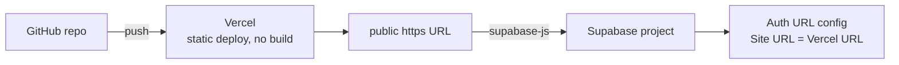

1. **Supabase:** create a project, run `supabase/schema.sql` and then `supabase/migrations/002_social_and_requests.sql` in the SQL editor (the second one is safe to re-run), disable *Confirm email* for the MVP (or configure SMTP), copy the Project URL and the anon key into `config.js`. Under *Authentication → URL Configuration* set the Site URL to your Vercel URL.
2. **Vercel:** import the GitHub repo, framework preset **Other**, no build command, output directory the repo root. Every push redeploys.
3. **`vercel.json`:** a recommended file is in `docs/vercel.example.json` (no-cache for `sw.js`, basic security headers, clean URLs). Use it as a reference for your own.
4. **Optional LLM:** `supabase functions deploy ask-hadota`, then `supabase secrets set LLM_URL=… LLM_KEY=… LLM_MODEL=…`.
5. **Optional voice:** render and commit `assets/voice/` (see §15).

## 18. Testing

| Command | Suite | What it proves |
|---|---|---|
| `npm test` | 49 Node tests: engine 16, learning 12, NLU 11, Supabase adapter 10 | Coffee rules on 1500 random questionnaires; the learner learns; opinions and spoken answers are understood; the Supabase calls, buckets and mappings are right (against a fake client) |
| `npm run test:py` | 10 analytics tests | The report detects a real improvement and refuses to invent one |
| `npm run e2e` | 14 browser checks (Playwright) | Questionnaire → result → rating → opinion → usage → reload |
| `npm run test:features` | 40 browser checks | Favourites, recipe pages, usage, product and article pages, one-time speech, voice answers, audio stops when hidden, join requests approved by every member, members-only content, news feed (post, photo, like, comment, repost), all routes without errors |
| `npm run test:voice` | 5 voice checks | Never the device voice; recorded clips used; every sentence has a clip line |
| `npm run sim` | Held-out evaluation | Regenerates the table in §13 |
| `npm run test:all` | Everything | |

Examples of what the engine tests assert: grind matches the method; brew ratios stay in accepted ranges (pour-over 1:13 to 1:18.5, French press 1:12 to 1:18.5, cold brew 1:6 to 1:9); water 88-96 °C; espresso is 9 g and 30 ml per shot; Turkish coffee is medium-dark and extra fine; an explicit roast, species or region is always respected; fruity wishes lead to lighter roasts than roasted ones; the lead bean beats a random bean for the same answers more than 90 % of the time; spices are never user add-ons.

During development two tests failed for reasons that were wrong *test assumptions* (espresso volume counted as water; neutral ratings still add exploration) and were corrected; nothing was loosened to hide an engine bug.

## 19. Analytics package

`analytics/` turns usage into answers: `loader.py` (Supabase CSV/JSON, in-app export, demo events) → `metrics.py` (learning curve, A/B lift with bootstrap interval, calibration, per-user improvement, exploration effect, tag effect, funnel, retention, segments) → `charts.py` (11 charts) → `report.py` (HTML report with plain-language verdicts).

```bash
pip install -r analytics/requirements.txt
python3 -m analytics.report --demo                       # demo data
python3 -m analytics.report --events events.csv          # your Supabase export
```

## 20. The catalog

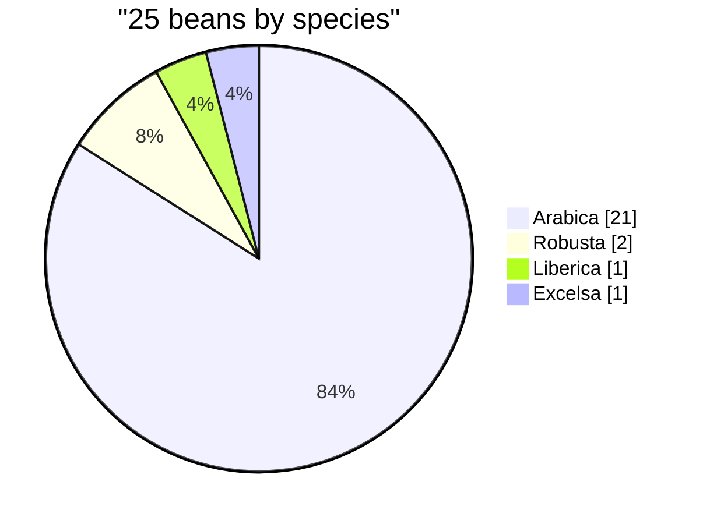

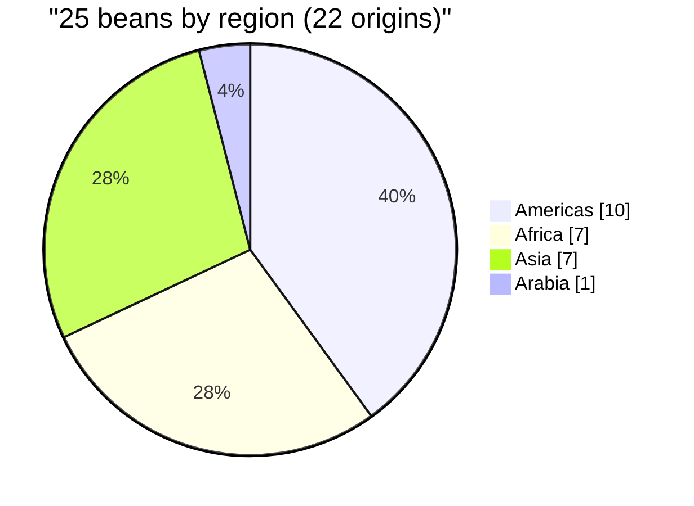

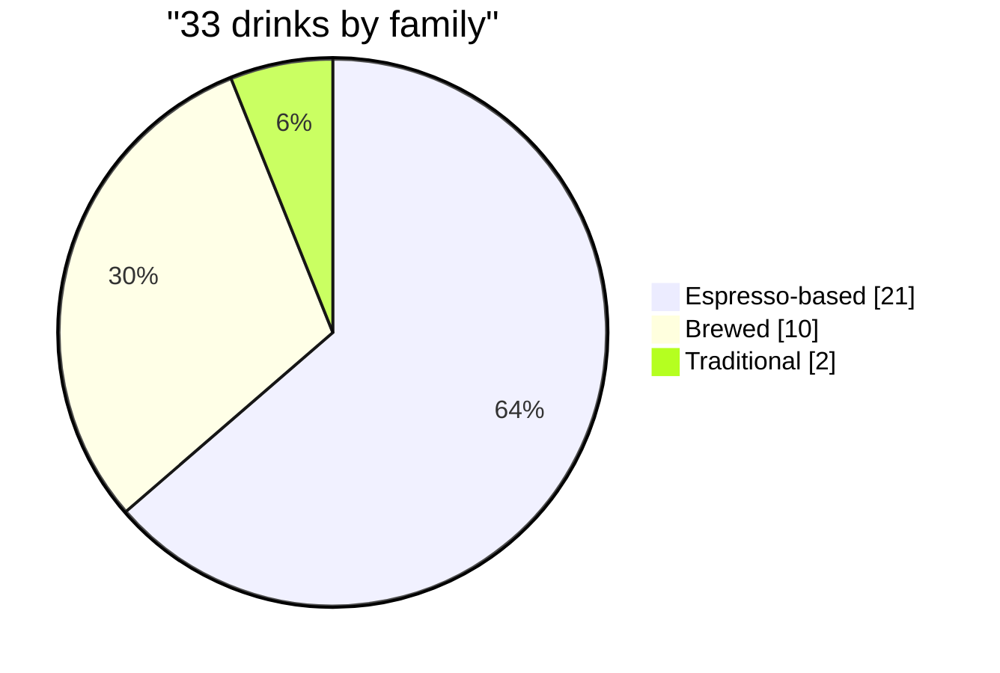

Also: **32 flavours** in 7 families (fruity 5, floral 4, sweet 5, nutty-cocoa 5, spices 6, roasted 4, other 3), **37 add-ons** (syrups 11, sauces 3, toppings 9, extras 5, plus rose and orange-blossom water), 8 milks, 8 sweeteners and 5 short articles. Bean attributes (acidity, body, sweetness, caffeine, notes, aroma families, roasts) were entered from public descriptions; **have a roaster or cupping panel review them** before trusting taste claims.

## 21. Limitations and roadmap

| Limitation | Plan |
|---|---|
| Real-user learning is unproven until the A/B arm has enough users | Collect about 30 users per arm, run the report, tune `REC_CFG` |
| Simulation uses the author's model of taste | Replace with real rating logs as they arrive |
| Free-text understanding is keyword-based | Add an LLM tag extractor behind the Edge Function, still mapped to the nine tags |
| Bean data and tahweeg ratios are not roaster-verified | Cupping review; store attributes in the database |
| Voice is the device voice until clips are rendered | Render `scripts/voice-lines.json` with VoiceTuT on Colab |
| No moderation, report button or rate limit in the community | Report flow, per-minute message limit in an Edge Function, terms and privacy page |
| Chat, tables and the feed poll (3-6 s) instead of using Realtime | Switch to Supabase Realtime channels |
| Videos are not transcoded (15 MB limit, mp4/webm); deleted posts leave their file in Storage | Transcoding service and a cleanup job |
| The claude.ai preview enforces privacy in the UI only | Use the Supabase deployment for real privacy |
| Hadota is silent until the male voice clips are rendered and committed | Run `scripts/render_voice.py` on Colab |
| Shop has no prices or payments | Payment provider and delivery after validation |
| Guests are not tracked remotely | By design: privacy first |

---

<div align="center"><sub>حدوتة · قهوة على مزاجك. وبالمصري. · Built with care for coffee addicts.</sub></div>
